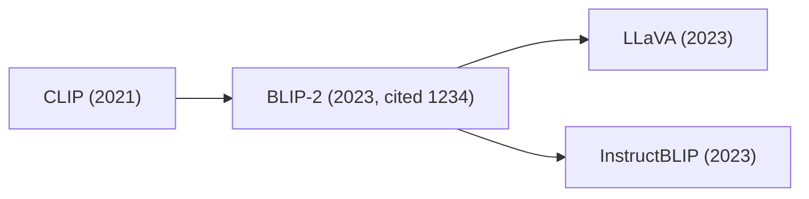

# Research MCP

> 개인용 연구 에이전트 — arXiv 검색·인용 그래프·멀티모달 논문 위키·시각화를 자연어 한 줄로 실행.
> **Claude Desktop (MCP)** 과 **self-hosted 웹 채팅 앱** 두 가지 인터페이스 사용.

---

## 주요 기능

### 1. 검색과 인용 그래프
- **arXiv 검색** — 키워드/카테고리로 검색하고 결과를 *최근 1년 / 3년 / 5년 / 그 이상* 으로 자동 분류.
- **인용 그래프** — 특정 논문의 references / citations를 가져와 정렬.
  - `sort="count"` — 절대 인용수 순.
  - `sort="velocity"` — **citation velocity** (`citations / (현재연도 − 발행연도)`) 순. 오래된 논문이 절대 인용수만으로 항상 이기는 문제를 보정해 최신 흐름에 가까운 결과를 보여준다.
- **인용 문맥 (citation contexts)** — Semantic Scholar의 `contexts` API로 *왜 인용했는지* 본문 스니펫을 수집.

### 2. 멀티모달 논문 위키 (Obsidian vault)
한 번 ingest한 논문은 폴더형 구조로 vault에 저장된다.

```
vault/papers/blip-2/
├── blip-2.md         # frontmatter + TL;DR / Methods / Findings / References (파일명 = 폴더 slug)
└── figures/
    ├── fig_1_overview-of-blip-2s-framework.png
    ├── fig_2_q-former-architecture.png
    └── ...
```

- **PDF 원본 보관** — `vault/pdfs/<arxiv_id>.pdf` 에 영구 저장.
- **Vision 기반 figure / table 추출** — vision 모델(기본 Qwen3-VL)로 figure·table 영역을 crop한다. *(`OPENROUTER_API_KEY` 필요)*
- **안정 hub 분류** — 큐레이트된 **hub 노트**에 1–3개로 매핑.
- **양방향 wikilink** — `[[clip]]` 같은 wikilink가 자동 누적.
- **vault 리트리벌** — `wiki_search`로 "질문 → 관련 노트"를 어휘 seed + `[[wikilink]]` 이웃 확장으로 검색.
- **종합 통찰 노트** — 세션에서 논문을 가로질러 얻은 통찰을 `insight-capture` 스킬로 `notes/<slug>.md`에 누적 (승인 게이트).

### 3. 시각화: Mermaid + Obsidian
한 anchor 논문을 중심으로 인용 흐름을 *카드 그래프* 로 출력.

- **Mermaid graph** — 응답에 즉시 임베드되어 Claude Desktop / GitHub / Obsidian이 그대로 렌더.
- **Mermaid 노트 저장** — 같은 다이어그램을 `vault/graphs/<slug>.md` 노트로도 저장. Obsidian이 노트를 열면 그래프로 렌더 (auto-layout이라 노드 겹침 없음).
- **통합 인용 네트워크 export** — vault 전체 논문의 인용 관계를 공통 노드(논문·hub) 기준 하나의 그래프로 통합해 CSV(Cosmograph)/GEXF(Gephi Lite)로 export. 엣지 200 이하 소형이면 `graphs/unified.md` Mermaid도 함께 산출.



### 4. 테크 블로그 다이제스트
- **테크 블로그 다이제스트** — Anthropic·Claude(claude.com)·OpenAI·DeepMind·Google Research 블로그의 신규 포스트를 몇 문단으로 요약해 `tech-blog-digest/<date>.md`에 누적. 실행할 때마다 소스별로 마지막 요약 이후 올라온 글만 처리한다.

---

## 아키텍처

```
sources/  →  analysis/  →  wiki/  →  tools/  ─┬─  server.py            (Claude Desktop · MCP)
                                              └─  agent/ → api/ → web/  (웹 앱)
```

---

## MCP Tools

| 카테고리 | Tool |
|---|---|
| **fetch** | `search_papers`, `get_paper_by_id`, `get_citation_contexts` |
| **graph** | `get_references_by_citations`, `get_citations_by_citations` |
| **artifact** | `download_paper`, `read_paper`, `extract_paper_figures`, `extract_paper_tables`, `prune_paper_figures`, `prune_paper_tables`, `render_paper_page` |
| **wiki** | `wiki_read_note`, `wiki_write_note`, `wiki_list`, `wiki_list_hubs`, `wiki_search`, `wiki_backlinks`, `wiki_link`, `wiki_prune_candidates`, `wiki_delete_paper` |
| **viz** | `build_citation_graph`, `export_citation_network` |
| **blog** | `get_tech_blog_posts`, `read_blog_post`, `mark_blog_posts_seen` |

---

## Skills

| 스킬 | 트리거 예시 | 하는 일 |
|---|---|---|
| `paper-ingest` | "이 논문 ingest", "`<arxiv_id>` 위키에 추가" | 메타·PDF·figure·table·요약을 한 번에 vault에 누적. 분야를 기존 hub에 매핑. |
| `citation-analysis` | "`<title>` 인용 흐름 보여줘", "`<arxiv_id>` 인용 분석" | anchor 1편 중심으로 refs/cites를 hub로 분류 + `cited_for` 채우기 + 시각화. |
| `wiki-lint` | "위키 점검", "vault 정리" | vault 정합성 점검 — orphan·깨진 링크·누락 교차참조·stale hub·노트 간 모순 스캔 → 승인 게이트 diff. |
| `wiki-prune` | "vault 프루닝", "안 쓰는 논문 지워줘" | vault 안에서 아무도 쓰지 않는 논문을 후보로 → 승인된 것만 노트·figure·PDF·그래프째 삭제 → wiki-lint로 깨진 링크 정리. |
| `insight-capture` | "이 통찰 저장", "notes에 정리" | 논문을 가로질러 종합한 통찰을 `notes/<slug>.md`에 누적 (승인 게이트). |
| `reading-queue` | "뭐 읽어야 하지", "읽을 논문" | vault가 참조하지만 아직 수록되지 않은 논문을 우선순위(P1~P4)로 보여줌. |
| `tech-blog-digest` | "테크 블로그 요약", "blog digest" | Anthropic·Claude·OpenAI·DeepMind·Google Research 신규 포스트를 본문 기반 요약해 `tech-blog-digest/<date>.md`에 누적 (소스별 마지막 요약 이후 글만). |
| `research-autopilot` | "밤새 논문 쌓아줘", `/loop 10m /research-autopilot scope=graph-rag,finance-agents` | 무인 축적 루프의 한 반복 — 대기열 유도 → 논문 1편 ingest → 인용 분석 → hub 판정 → 깨진 링크 정정을 자동 승인으로 수행. |

---

## 설치

[uv](https://github.com/astral-sh/uv)를 설치한 뒤 진행한다.

### 플러그인 설치 (권장 — Claude Desktop / Claude Code)

```
/plugin marketplace add cholhwanjung/research-mcp
/plugin install research-mcp@research-mcp-local
```

데스크톱 앱에서는 Code 탭 세션에 위 두 줄을 입력한다. 도구 26개와 스킬 8개가 함께 설치된다.

설치할 때 아래 설정을 입력한다. 모두 선택 항목이며, 나중에 `/plugin configure research-mcp@research-mcp-local`로 바꿀 수 있다. **secret은 repo가 아니라 keychain에 저장된다.**

| 설정 | 설명 |
|---|---|
| `vault_path` | vault 루트 (예: `/Users/you/Documents/research-wiki`). 기본값 `~/Documents/research-wiki` |
| `openrouter_api_key` | Qwen3-VL(OpenRouter) — figure/table 추출에 사용 |
| `google_api_key` | figure/table 추출을 Gemini로 바꿔 쓸 때만 필요 |
| `ss_api_key` | Semantic Scholar API key — API 요청 한도 상향 |

업데이트는 `claude plugin update research-mcp@research-mcp-local`을 실행하고 새 세션을 연다. vault는 Obsidian으로 열어 노트와 그래프를 본다.

### Claude Desktop MCP 설정 (수동 — 대안)

도구만 필요할 때 MCP 서버를 직접 등록한다.

`~/Library/Application Support/Claude/claude_desktop_config.json` 에 추가:

```json
{
  "mcpServers": {
    "research": {
      "command": "uv",
      "args": ["--directory", "/path/to/research-mcp", "run", "python", "server.py"],
      "env": {
        "OBSIDIAN_VAULT_PATH": "/Users/you/Documents/research-wiki",
        "OPENROUTER_API_KEY": "<Qwen3-VL — figure/table 추출용>",
        "SS_API_KEY": "<optional Semantic Scholar API key>"
      }
    }
  }
}
```

| 변수 | 기본값 | 설명 |
|---|---|---|
| `OBSIDIAN_VAULT_PATH` | `~/Documents/research-wiki` | 노트·PDF·figure 저장 vault 루트 |
| `PDF_PATH` | `$OBSIDIAN_VAULT_PATH/pdfs` | PDF 원본 저장 위치 |
| `OPENROUTER_API_KEY` | (없음) | Qwen3-VL(OpenRouter) — figure/table bbox 추정에 필요 |
| `VISION_MODEL` | `openrouter:qwen/qwen3-vl-235b-a22b-instruct` | figure/table 추출 모델 `<provider>:<model>` (예: `google:gemini-3.8-flash`) |
| `GOOGLE_API_KEY` | (없음) | `VISION_MODEL`이 `google:`일 때 필요 |
| `SS_API_KEY` | (없음) | Semantic Scholar API key — API 요청 한도 상향 |
| `OPENALEX_API_KEY` | (없음) | OpenAlex API key(무료) — 인용 수집 보강에 사용 |

---

## 웹 앱 (self-hosted) — 멀티 LLM 채팅

Claude Desktop 외에, 같은 도구·워크플로우를 **웹 채팅 UI**로도 쓸 수 있음.

### 구성
- `api/` — FastAPI + SSE 백엔드. `/chat`(스트리밍·승인 재개) · `/snapshots/{id}/restore` · `/skills` · `/health`. Bearer 토큰 인증.
- `agent/` — Pydantic-AI 하네스(provider 무관). MCP의 tool 재사용 + vault 작업 공간(읽기·쓰기·편집·찾기·검색) + 스킬 점진 로딩 + 읽기 전용 위임 + autopilot 작업 도구.
- `web/` — Next.js 채팅 프론트 (스트리밍 + 승인 카드·되돌리기 + 권한 모드·모델 선택 + 토큰 입력).

### 권한 — 승인·모드·되돌리기
- 파일 경로는 vault 안만 받는다(`..`·절대경로·심볼릭 링크 탈출 거부, `.obsidian/`·`.git/` 쓰기 거부). 셸·코드 실행 도구는 없다.
- 모드(우상단): **확인 후 편집**(기본 — vault 쓰기·설정 변경·삭제·비용 작업 전에 승인 카드) · **편집 자동 허용**(vault 편집은 바로, 삭제·비용 작업은 승인) · **읽기 전용**.
- 승인 카드에 diff·삭제 대상·비용 안내가 보인다. **허용** / **이 세션 동안 허용**(편집 도구만) / **거부**.
- 에이전트가 쓴 파일은 도구 카드의 **되돌리기**로 쓰기 전 내용으로 돌린다. 스냅샷·감사 로그(`key=value`)는 vault 밖 `RESEARCH_AGENT_STATE_DIR`(기본 `.cache/agent`)에 쌓인다.
- `RESEARCH_API_TOKEN`이 없으면 서버가 읽기 전용으로 고정된다 — 쓰기·autopilot 시작은 토큰을 설정한 뒤에.
- 채팅의 "autopilot 시작·멈춰·보고·오늘은 X로"는 autopilot 작업 도구(독립 런타임 루프, 시작·설정은 승인)로 간다.

### 실행 — 한 번에 (로컬, 추천)
```bash
cp .env.example .env       # 쓸 provider 키만 채우기 (예: GOOGLE_API_KEY)
./run-web.sh               # .env 의 RESEARCH_MODEL (미설정 시 Claude)
./run-web.sh google        # Gemini  — GOOGLE_API_KEY 만 있으면 됨 (Anthropic 키 불필요)
./run-web.sh openai        # GPT-4o  — OPENAI_API_KEY
./run-web.sh anthropic     # Claude  — ANTHROPIC_API_KEY
```
→ 백엔드(:8000)+프론트(:3000) 동시 기동. 접속: **http://localhost:3000**
- 인자로 고른 모델이 백엔드 기본값(`RESEARCH_MODEL`)으로 적용 (웹 UI에서 메시지별 전환도 가능). `provider:model` 직접 지정도 됨 (예: `./run-web.sh google:gemini-2.0-flash`).
- 선택한 provider 키가 없으면 시작 전에 안내한다.
- Ctrl-C 한 번으로 둘 다 종료. 최초 1회 `uv sync`·`npm install`이 자동으로 실행된다.
- `.env`는 백엔드(`core/config.py`)가 자동 로드, 프론트 기본 API_URL은 `http://localhost:8000`.

**사용**: 우상단 토큰칸에 `RESEARCH_API_TOKEN` 값 입력 → 채팅 (토큰 없이 띄운 서버는 읽기 전용). 예: `"<arxiv_id> 위키에 추가해줘"` → 채팅에 tool 실행 흐름 표시 → **Obsidian을 열어** 노트·그래프 확인.

### 실행 — Docker (self-hosted 배포)
```bash
cp .env.example .env        # provider 키 + VAULT_HOST_PATH 채우기
docker compose up --build   # 백엔드 → http://localhost:8000
```
- `VAULT_HOST_PATH`에는 Docker 파일 공유 대상 경로를 지정한다 (예: 홈 하위 `~/Documents/...`).
- 세션 SQLite는 named volume(`sessions`)에 저장한다.
- 프론트는 아래 "수동 실행"의 프론트 명령으로 기동한다.

### 수동 실행 (개별 기동, 선택)
`run-web.sh` 대신 백엔드·프론트를 따로 띄울 때:
```bash
uv run uvicorn api.main:create_app --factory --port 8000   # 백엔드
cd web && npm run dev                                       # 프론트(:3000)
```
백엔드를 비표준 호스트/포트로 띄우면 `web/.env.local`에 `NEXT_PUBLIC_API_URL=…` 지정.

### 환경 변수 (웹 앱)
| 변수 | 설명 |
|---|---|
| `RESEARCH_API_TOKEN` | 설정 시 API 호출에 `Authorization: Bearer` 강제. 비우면 인증 off + 읽기 전용(쓰기·autopilot 시작 도구 숨김) |
| `RESEARCH_AGENT_STATE_DIR` | 스냅샷·감사 로그 폴더 (기본 `.cache/agent`, compose는 `/data/agent`) |
| `RESEARCH_MODEL` | 기본 채팅 모델 (`anthropic:…` / `openai:…` / `google:…`) |
| `ANTHROPIC_API_KEY` / `OPENAI_API_KEY` / `GEMINI_API_KEY` | 사용할 provider 키 |
| `OPENROUTER_API_KEY` | Qwen3-VL — figure/table 추출 (ingest 시) |
| `VAULT_HOST_PATH` | (compose) host vault 절대경로 → 컨테이너 `/vault` |

---

## Vault 레이아웃

```
vault/
├── papers/
│   └── <title-slug>/
│       ├── <title-slug>.md  # frontmatter + 본문 (TL;DR / Methods / Findings / References)
│       └── figures/
│           └── fig_<n>_<caption-slug>.png
├── topics/
│   └── <hub-slug>.md        # 안정 hub — 백링크로 논문이 자동 집계
├── notes/
│   └── <slug>.md            # 논문 간 종합 통찰 (insight-capture)
├── tech-blog-digest/
│   └── <date>.md            # 테크 블로그 다이제스트 노트
├── research-autopilot/
│   └── <date>.md            # autopilot 실행 보고서 (정지 시 생성)
├── graphs/
│   └── <slug>.md            # 인용 흐름 Mermaid 노트 (build_citation_graph)
└── pdfs/
    └── <arxiv_id>.pdf
```

---